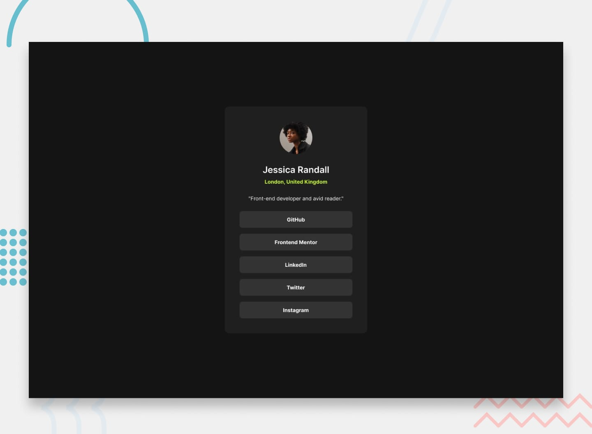

# Social Links Profile - Frontend Mentor

Este projeto é a minha resolução para o desafio [Social links profile](https://www.frontendmentor.io/challenges/social-links-profile-UGt22HStandard) da plataforma Frontend Mentor, desenvolvido para praticar a estruturação e estilização de interfaces.

## 📷 Prévia

## 🛠️ Tecnologias Utilizadas

- **HTML5** 
- **CSS3** 

## 🌐 Solução Online

Você pode visualizar a aplicação rodando na prática através do link abaixo:

- **GitHub Pages:** [Acessar demonstração](https://SEU_USUARIO.github.io/social-links-profile/)

---
Feito com 💜 por **Larissa**  
GitHub: [@codebylarissa](https://github.com/codebylarissa)